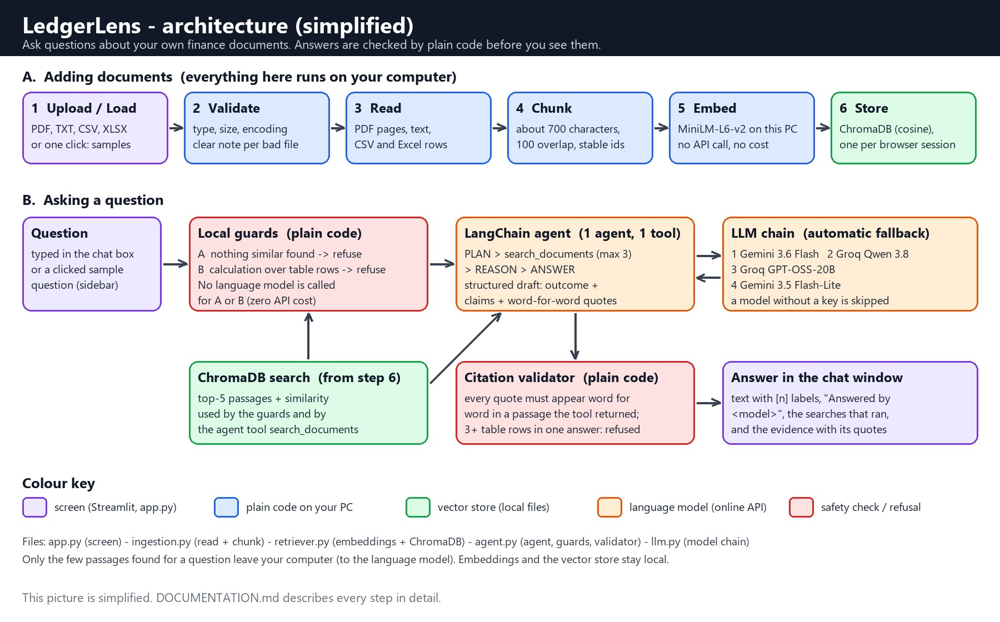

# 📒 LedgerLens - Technical Documentation

| | |
|---|---|
| **Name** | Seema Bhosale |
| **Email** | seemabhosale5997@gmail.com |
| **Mobile No** | 7755999433 |
| **Batch** | Morning Batch 13 |
| **Project** | LedgerLens - a question-answering assistant for Corporate Finance & Expense Management documents |

**In three lines.** LedgerLens lets you upload finance documents (PDF, TXT, CSV, Excel) and ask questions in plain English. One LangChain agent searches a local vector database, and answers only from what it found. Every quote it shows is checked by ordinary code, so an invented citation can never reach the screen.

**Looking for the "how do I run it" guide?** That is the [README.md](README.md). This file explains how the system is built, why, and where its limits are.

**Contents**
1. [At a glance](#1-at-a-glance)
2. [System setup](#2-system-setup)
3. [Architecture](#3-architecture)
4. [How the RAG pipeline works](#4-how-the-rag-pipeline-works)
5. [Agent roles and reasoning flow](#5-agent-roles-and-reasoning-flow)
6. [Reliability and safety controls](#6-reliability-and-safety-controls)
7. [Technology stack and why](#7-technology-stack-and-why)
8. [Deployment steps](#8-deployment-steps)
9. [Testing](#9-testing)
10. [Limitations and known issues](#10-limitations-and-known-issues)
11. [Challenges faced during development](#11-challenges-faced-during-development)
12. [Future improvements](#12-future-improvements)

---

## 1. At a glance

| Item | Choice |
|---|---|
| Domain | Corporate Finance & Expense Management (expense policy, audit memo, expense-request table, sales table) |
| User interface | Streamlit 1.63 (one page, three numbered sidebar sections) |
| Agentic framework | **LangChain 1.x** (1.4.0) - the only framework used |
| Number of agents | **1 agent with 1 tool** (`search_documents`) |
| First language model | Google Gemini `gemini-3.6-flash` |
| Fallbacks, in order | Groq `qwen/qwen3.8-27b` → Groq `openai/gpt-oss-20b` → Gemini `gemini-3.5-flash-lite` |
| Embeddings | `sentence-transformers/all-MiniLM-L6-v2`, run **on your own computer** (free) |
| Vector database | ChromaDB 1.5.9, cosine distance, HNSW index with thorough settings |
| File formats | PDF, TXT, CSV, XLSX (other types are refused with an explanation) |
| Python | Developed and tested on Python 3.11.9 (3.10 - 3.13 are expected to work) |
| Sample data | 4 documents: a 20-page expense policy (PDF), an audit memo (TXT), an expense-request table (CSV, 642 rows), a sales table (XLSX, 9,999 rows) |

---

## 2. System setup

**Quick start (Windows, from the ZIP):**

```
cd seemabhosale_capstone_morning_batch_13
python -m venv .venv
.venv\Scripts\activate
pip install -r requirements.txt
streamlit run app.py
```

The README explains every step for beginners (and the one-click alternative, `start_ledgerlens.bat`).

**Settings in `.env`** (a template is in `.env.example`):

| Variable | Meaning | Default |
|---|---|---|
| `GOOGLE_API_KEY` | Gemini key (needed for the first and last model in the chain) | none |
| `GROQ_API_KEY` | Groq key (the two middle models; optional but recommended) | none |
| `GEMINI_MODEL` | Main Gemini model | `gemini-3.6-flash` |
| `GEMINI_BACKUP_MODEL` | Second Gemini model on the same key | `gemini-3.5-flash-lite` |
| `GROQ_MODEL` | Main Groq model | `qwen/qwen3.8-27b` |
| `GROQ_BACKUP_MODEL` | Second Groq model on the same key | `openai/gpt-oss-20b` |
| `PRIMARY_LLM` | Set to `groq` to ask Groq before Gemini | `gemini` |

A blank value, or a model name that the provider has retired, is silently replaced by the current default (`llm.py` keeps the retired names in two sets). The app also works with only one of the two keys.

**Project layout**

```text
app.py                      screen (no business logic)
agent.py                    agent, search tool, local guards, fallback loop, citation validator
llm.py                      model chain, key checks, friendly error texts
ingestion.py                file reading, validation, chunking, uploaded_documents helpers
retriever.py                MiniLM embeddings, ChromaDB store, semantic search
requirements.txt  .env.example  .streamlit/config.toml
start_ledgerlens.bat        one-click start for Windows
architecture_diagram.jpg    the picture used in section 3
sample_documents/           4 demo files + error_test_files/ (7 deliberately bad files)
chroma_db/  uploaded_documents/   created at run time (only .gitkeep is shipped)
tests/test_ledgerlens_suite.py  tests/smoke_ledger_pipeline.py  tests/ping_llm_chain.py
```

---

## 3. Architecture



*Figure 1. A simplified picture. The text diagram below shows the same system with a little more detail.*

```text
+--------------------------------------------------------------------------------------+
|                               Streamlit page  (app.py)                               |
|  sidebar: model status | "Load sample finance documents" | uploader | sample questions |
|  main:    chat window -> answer + "Answered by <model>" + search trace + evidence     |
+---------------+------------------------------------------------------+---------------+
                | files (bytes)                                        | question
                v                                                      v
+-------------------------------+                     +-----------------------------------+
|  INGESTION  (ingestion.py)    |                     |  AGENT  (agent.py, LangChain)     |
|  1 type / size / encoding     |                     |  0 local guards: nothing relevant |
|  2 PDF, text, CSV, Excel      |                     |    or a calculation over rows?    |
|    loaders                    |                     |    refuse, no model is called     |
|  3 friendly error per file    |                     |  1 PLAN     (language model)      |
|  4 chunks of ~700 characters  |                     |  2 RETRIEVE tool search_documents |
+---------------+---------------+                     |  3 REASON   (up to 3 searches)    |
                | chunks                              |  4 ANSWER   (structured draft)    |
                v                                     |  5 VALIDATE quotes (plain code)   |
+-------------------------------+   semantic search   +----------+----------------+-------+
|  RETRIEVER  (retriever.py)    |<-------------------------------+                |
|  MiniLM embeddings (local)    |   top-5 passages + similarity                   | model call
|  ChromaDB collection (cosine) |                                                 v
|  one collection per session   |                          +------------------------------+
+-------------------------------+                          |  MODEL CHAIN  (llm.py)       |
                                                           |  Gemini > Groq > Groq 2nd >  |
   uploaded_documents/  <- copies of uploaded files        |  Gemini 2nd  (automatic)     |
   chroma_db/           <- vector data                     +------------------------------+
```

**Data flow in one sentence:** files become small passages, passages become vectors in a local database, a question is matched against those vectors, a language model drafts an answer from the best passages, and plain code confirms that every quote really exists before the answer is shown.

| Module | Responsibility |
|---|---|
| `app.py` | Draws the page, keeps the browser session's state, calls the other modules. No business logic. |
| `ingestion.py` | Checks and reads files, turns every problem into one friendly message, cuts text into passages with stable ids, and manages the copies in `uploaded_documents/`. |
| `retriever.py` | Loads the local MiniLM model, creates one ChromaDB collection per browser session, indexes passages, and runs the similarity search (distance converted to similarity). |
| `agent.py` | The LangChain agent and its single tool, the two local guards, the citation validator, the cool-down memory and the loop over the model chain. |
| `llm.py` | Builds the four models, resolves model names, tells real keys from placeholders, performs the quota-free key check and describes errors in plain words. |

---

## 4. How the RAG pipeline works

RAG (Retrieval-Augmented Generation) means: *first look up the facts, then let a language model write the answer from those facts only.*

| # | Step | Where | Key settings |
|---|---|---|---|
| 1 | **Validate** | `ingestion.read_document` | Allowed types PDF/TXT/CSV/XLSX; 20 MiB per file; the file name is cleaned; text encoding detected (UTF-8, UTF-16 with BOM, Windows-1252); Excel workbooks may not unzip to more than 100 MiB |
| 2 | **Read** | `ingestion.py` | PyPDF (one passage per page), TextLoader, CSVLoader (one passage per row), a small custom Excel loader (one passage per row, every sheet). Limits: 2 million characters, 20,000 records |
| 3 | **Chunk** | `ingestion.split_into_chunks` | 700 characters, 100 overlap. Short chunks keep MiniLM (about 256 word pieces) from cutting text off. Every chunk gets a stable `chunk_id` (SHA-256), so indexing twice never duplicates |
| 4 | **Embed** | `retriever.get_embeddings` | `all-MiniLM-L6-v2`, normalised vectors, CPU, all logical processors. The first start downloads about 90 MB |
| 5 | **Store** | `retriever.initialize_vector_store` | ChromaDB, cosine space, HNSW `max_neighbors=64`, `ef_construction=800`, `ef_search=2000`; batches of 128 |
| 6 | **Retrieve** | `retriever.semantic_search` | Top 5 passages, minimum similarity 0.30. The agent's tool may search up to 3 times per question |
| 7 | **Generate** | `agent.py` + `llm.py` | The model must call the `DraftReply` tool with an outcome and claims, each claim carrying a verbatim quote |
| 8 | **Validate** | `LedgerAgent._validate` | Plain code checks every quote against the passages that were really retrieved |

**One collection per browser session.** The page creates a collection named `docs_<32 hex characters>` when a session starts, so two people using the same server never see each other's documents. "Clear knowledge base" deletes the collection and starts a new name. At every app start, leftovers in `chroma_db/` and `uploaded_documents/` are removed.

**Distance versus similarity.** ChromaDB reports cosine *distance* (0 means identical). `semantic_search` converts it itself with `similarity = max(-1, min(1, 1 - distance))` and compares that with the 0.30 threshold, instead of trusting any library's default "relevance" scaling.

**Why the HNSW settings are generous.** Chroma's stock index is approximate. In a collection that holds a few policy paragraphs among thousands of near-identical table rows it can miss the true best passage. The collections here are small, so a thorough search costs milliseconds. Section 9 reports what was measured on the sample data.

---

## 5. Agent roles and reasoning flow

| Role | What it does | Done by |
|---|---|---|
| **Planner** | Works out what the user wants and which words a matching passage would contain | Language model (first step of the agent's prompt) |
| **Retriever** | `search_documents`: runs the similarity search and returns numbered passages | Plain code (the single tool) |
| **Reasoner** | Checks whether the passages really support a complete answer, and searches again with other words if not (3 searches at most) | Language model |
| **Answerer** | Calls the `DraftReply` tool once: an outcome plus short claims, each with a source number and a word-for-word quote | Language model |
| **Validator** | Verifies every quote, applies the "not three table rows" safety net, and writes the final text | Plain code |

```text
question
   |
   v
local checks (plain code)  --nothing similar found-->  fixed "not found" message   (no model called)
   |                       --calculation over table rows-->  fixed "needs calculation" message (no model called)
   v
PLAN  ->  RETRIEVE (search_documents, up to 3 times)  ->  REASON  ->  ANSWER (DraftReply)
   |
   v
VALIDATE (plain code): quotes verbatim? sources real? not 3+ table rows?
   |
   v
answer with [n] labels + evidence    (or a fixed refusal text)
```

**The five outcomes** the model can choose from:

| Outcome | Meaning | What the user sees |
|---|---|---|
| `answered` | Claims backed by verbatim quotes | The claims, each followed by `[n]`, and an evidence box |
| `not_in_documents` | The passages do not contain the answer | The fixed "could not find solid evidence" text |
| `needs_calculation` | Counting, summing, ranking or comparing many rows | The fixed "needs calculation" text |
| `unclear_question` | Vague or depends on earlier chat | The fixed "please ask a complete question" text |
| `unsafe_request` | An attempt to change the rules or leak secrets | The fixed "I cannot help with that" text |

The wording of the four refusals lives in the code, so a model cannot be talked into saying something else.

**The model chain.** `Gemini → Groq → Groq (second model) → Gemini (second model)`: two companies first (the best spare during an outage), then each company's second model (same key, separate quota bucket). A company without a real key is skipped. If a model fails, the next one answers, and the failed one is moved to the *end* of the line for a while (it is tried last, not skipped).

| Failure | How long that model waits at the back |
|---|---|
| Outage, timeout, glitch | 90 seconds |
| Rate limit with a "try again in X" hint | X + 2 seconds (at least 5, at most 15 minutes) |
| Rate limit without a hint | 180 seconds |
| Daily quota | at least 15 minutes (longer if the provider says so) |

A model that returns a **malformed tool call** (a known glitch of some open models) gets one retry on the same model before the chain moves on.

**What the user sees under an answer:** `Answered by <model>` (and "spare model" when the first one failed), the searches the agent ran, and an evidence box with each cited file, page or sheet/row, every verified quote and a "View full passage" pop-over. When a local guard answered, a grey note says that no language model was called.

---

## 6. Reliability and safety controls

| Risk | Control |
|---|---|
| Unsupported files (`.docx`, `.zip`, `.xls`, pictures, slides) | The extension is checked first; a specific message says what the file is and what to do ("Save As PDF", "unpack the archive") |
| Empty, blank, scanned or header-only files | Skipped with a reason, for example "contains no selectable text (it may be a scan, and OCR is not supported)" |
| Corrupted, renamed or password-protected files | Loader errors become short per-format messages; a locked PDF is named as such; other files keep loading |
| Oversized or malicious files | 20 MiB per file, 25 MB Streamlit upload cap, character and record limits, Excel unzipped-size check |
| Path tricks in file names | Only a cleaned final name is used; loaders read a temporary file with a fixed name |
| Odd encodings | UTF-8, UTF-16 with BOM, Windows-1252 (Excel's CSV default); binary data is refused |
| Long or empty questions | Input is limited to 2000 characters; empty questions are refused |
| Hallucination | Answers come only from retrieved passages; every claim needs a verbatim quote that code has verified; otherwise a fixed refusal |
| No relevant data | Local similarity threshold: when nothing matches, no language model is called |
| Maths over spreadsheet rows | Rows are retrieved one by one, so counts, sums and rankings are never computed. Three layers: (1) a **local check** - an aggregation word plus best matches that are table rows → refusal before any model call; (2) the prompt tells the model to answer `needs_calculation`; (3) a **safety net** after validation: an answer that combines 3 or more different table rows is discarded. Layers 1 and 3 are plain code |
| Prompt injection (in questions or documents) | Text is declared untrusted data; the agent has no tool except search; refusal wording is fixed; the answer is validated afterwards. Questions with no similar passage never reach a model at all |
| Model outage, quota or retired model | Automatic fallback through up to four models (two companies); a retired name in `.env` is replaced by the current default; if all fail, a clear message without raw error text |
| Secrets | Keys live in `.env` (git-ignored); never shown in the page or logs (`redact`, hidden in `repr`); the sidebar key box is session-only |
| Runaway agent | At most 3 searches per question, a step limit, a 45-second model timeout |
| Privacy | Embeddings run locally; only the retrieved passages leave the computer (to the language model); LangChain tracing is not used |
| No internet on the very first start | The embedding-model download failure is caught and explained |
| Status light spending free quota | The sidebar check only asks for account metadata (never a generation) and is remembered for 10 minutes |

---

## 7. Technology stack and why

| Tool | Used for | Why this one |
|---|---|---|
| Streamlit | The web page | A complete chat interface in a few dozen lines of Python; nothing else to install for a browser |
| LangChain 1.x | The agent (`create_agent`), tool calling, structured output | The framework the course suggests; its structured-output tool strategy makes the model return a checkable draft |
| Google Gemini | First and last model of the chain | Generous free tier, good at tool calling |
| Groq | Second and third model of the chain | A different company, so an outage at one does not stop the other; fast |
| all-MiniLM-L6-v2 | Embeddings | Small (about 90 MB), free, runs on a normal laptop CPU, good for English |
| ChromaDB | Vector database | Runs in the same process, stores files in a folder, no server to set up |
| pypdf, pandas, openpyxl | Reading PDF, CSV and Excel | Light and reliable; avoids the very heavy `unstructured` package |
| pydantic | The `DraftReply` schema | Validates the model's structured answer |
| python-dotenv | Loading `.env` | Keeps keys out of the source code |

---

## 8. Deployment steps

> **Status: documented, not performed.** LedgerLens was built and tested on a local Windows computer. This section describes how it could be deployed. No cloud deployment was done and there is no live address. The submission route is the ZIP file, which an evaluator runs locally.

### A. Locally, from the ZIP (the main route - tested)

1. Unzip `seemabhosale_capstone_morning_batch_13.zip`. It contains one folder with the same name.
2. Open a terminal in that folder and create the environment: `python -m venv .venv`.
3. Activate it (Windows Command Prompt: `.venv\Scripts\activate`; Mac/Linux: `source .venv/bin/activate`).
4. `pip install -r requirements.txt` (several minutes; it downloads large packages).
5. `streamlit run app.py`, then open <http://localhost:8501> if the browser does not open by itself.

On Windows, double-clicking `start_ledgerlens.bat` does steps 2 - 5 automatically.

### B. Streamlit Community Cloud (not performed)

1. Put the project in a GitHub repository (without `.env`; the `.gitignore` already excludes it).
2. On share.streamlit.io choose **New app**, pick the repository and branch, and set **Main file path** to `app.py`. Choose Python 3.11 under *Advanced settings*.
3. In *Advanced settings → Secrets* paste the keys in TOML form (top-level secrets are also available to the app as environment variables, which is what `llm.py` reads):

   ```toml
   GOOGLE_API_KEY = "your-gemini-key"
   GROQ_API_KEY = "your-groq-key"
   ```
4. Deploy. The first start downloads the embedding model (about 90 MB).

Things to watch: the free tier has limited memory (PyTorch plus the model is heavy), and the disk is not permanent, which suits this app because it rebuilds its vector data every start anyway.

### C. Hugging Face Spaces (not performed)

1. Create a new Space and choose the **Streamlit** SDK.
2. Upload the project files (without `.env`) and make sure the top of the Space's `README.md` has `sdk: streamlit` and `app_file: app.py` in its front matter.
3. Under *Settings → Variables and secrets* add `GOOGLE_API_KEY` (and `GROQ_API_KEY`) as **secrets**.
4. The Space builds from `requirements.txt` and starts the app.

### Why not Netlify or Vercel?

Netlify and Vercel host static sites and short-lived serverless functions. Streamlit needs a Python process that keeps running and talks to the browser over WebSockets. In addition, PyTorch and ChromaDB are larger than the size limits of serverless functions. A host that runs a long-lived Python server (Streamlit Community Cloud, Hugging Face Spaces, a small virtual machine or a container) is the right kind of place.

---

## 9. Testing

| Check | Command | What it proves |
|---|---|---|
| Unit tests (offline, no keys, no internet) | `python -m unittest discover -s tests` | Ingestion, chunking, retrieval conversion, the validator, the agent loop with a scripted fake model, the fallback chain, the local guards, rate-limit logic |
| Setup check (internet once, no key) | `python tests/smoke_ledger_pipeline.py` | Real files are read, a real index is built and searched, and an off-topic question is refused locally |
| Key check | `python tests/ping_llm_chain.py` | Every model of the chain answers with the keys in `.env` |
| Live questions | run through the real agent (see results) | Answerable questions are answered with verified citations; declined questions are refused |
| UI test | see results | The page works end to end |

**Measured results** (every number below was measured on the development computer: Windows 11, Intel Core i5-6200U, 2 cores / 4 threads):

| Check | Result |
|---|---|
| Unit tests (Python 3.11.9, offline, no keys) | **156 tests, all pass.** 4.9 s of test time on the development copy; 8.2 s in a fresh virtual environment built from the ZIP. The whole command needs about 30 s (and about 100 s the very first time, while Python prepares the libraries) on the slow test laptop |
| Python versions tested | Only **3.11.9**. Python 3.14.8 is also installed on that PC but is outside the tested range and was not used; 3.13 was not installed, so it was not tested |
| Setup check (`smoke_ledger_pipeline.py`) | `ALL CHECKS PASSED` in 91 s: 2,229 passages embedded and stored in 65 s; the meal limit was found at rank 2, the exact sales row at rank 2, the cash-advance rule at rank 3; an off-topic question was refused with no model call |
| Key check (`ping_llm_chain.py`) | **4 of 4** models answered `[OK]`: `gemini-3.6-flash`, `qwen/qwen3.8-27b`, `openai/gpt-oss-20b`, `gemini-3.5-flash-lite` |
| Passages in the four samples | 80 (policy PDF) + 7 (memo) + 642 (claims CSV) + 9,999 (sales sheet) = **10,728** |
| Indexing time for all four samples (the "Load sample" button) | about 4 to 4.5 minutes (243 s and 274 s in two measured runs) on an Intel Core i5-6200U laptop (2 cores / 4 threads). Embedding alone ran at about 54 passages per second |
| Retrieval versus exact brute-force search (16 questions, index rebuilt in a different order each time) | **Thorough settings used by the app: best passage missing in 0 of 128 checks, top-5 identical to exact search in 128 of 128.** Chroma defaults: best passage missing in 10 of 48 checks (21%) |
| Live questions that should be answered (real agent, real 10,728-passage index) | **10 of 10 correct** with verified citations, plus the multi-search comparison question (answered with both figures cited) |
| Live questions that should be declined | **10 of 10 declined**: 6 by the local checks in 0.1 - 0.3 s with no model call, 3 by the model after searching, 1 by the model as an unsafe request |
| UI walk-through (`check_ui_flow.py`) | All checks pass: bad files explained, valid CSV still indexed, Clear, Load sample (10,728 passages), all 7 sample buttons, wrong-key fallback. Development copy 485 s (one over-strict check was fixed and re-run in 120 s); extracted ZIP 493 s |
| Evaluator rehearsal (ZIP extracted to a new folder, new venv) | `pip install -r requirements.txt` exit code 0; `pip check` clean; app health answered after 7 s with `streamlit run app.py --server.headless true`; `start_ledgerlens.bat` started a healthy app after 48 s; the final ZIP is about 1.9 MB (limit: 19 MB) |
| Provider failures met during live runs | Groq `qwen/qwen3.8-27b`: HTTP 429 on input tokens per minute (limit 7,000). Groq `openai/gpt-oss-20b`: HTTP 429 on tokens per minute (limit 8,000). Gemini `gemini-3.6-flash`: 503 "high demand". Each time a later model of the chain answered |

**Transparency note on which models answered.** To spare the small free Gemini quota, the bulk live runs asked Groq first (`PRIMARY_LLM=groq` was set for that process only, never in `.env`). Most answers came from `qwen/qwen3.8-27b`. Gemini answered three of the declined questions after Groq was rate-limited, `openai/gpt-oss-20b` answered one question (and, as noted in section 11, got it wrong), and `gemini-3.5-flash-lite` answered the per-diem comparison after the three other models had failed in turn. The wrong-key test deliberately breaks Gemini and shows Groq taking over. The default order (Gemini first) was exercised by the status panel and the first-load checks, which call only account metadata.

---

## 10. Limitations and known issues

* **No calculations across rows.** Totals, counts, averages and rankings over table rows are refused on purpose. Passages are retrieved one at a time, so such answers would be guesses. A pandas-based tool would be the proper fix (section 12).
* **Approximate retrieval.** Meaning-based search is not exact search. It finds policy text and long, distinctive descriptions very well, but a very short quoted value, or a date alone among thousands of near-identical rows, may not surface (section 9 lists measured examples).
* **No OCR.** Scanned pages and pictures contain no selectable text and are skipped. In the sample policy, pages 17 - 19 (sample forms) only yield their headings for this reason.
* **English-centric embeddings.** MiniLM works best on English text.
* **A verified quote proves the quote exists, not that it fully answers the question.** The validator catches invented quotes; it cannot judge whether a real quote is the best evidence.
* **No conversation memory.** Every question stands alone ("what about him?" is declined).
* **The knowledge base belongs to one browser session.** Refreshing the page or opening a new tab starts with an empty knowledge base.
* **The first start needs internet** (the 90 MB embedding model) and indexing is CPU-bound: the full set of sample documents takes about 4 to 4.5 minutes (243 s and 274 s in two measured runs) on the development computer on the development computer.
* **Free-tier limits.** Free keys allow only a few requests per day per model; the chain softens this but cannot remove it.
* **Retrieved text leaves the computer.** The passages found for a question are sent to the language model provider. Do not use confidential finance data without an approved agreement.
* **Answer quality differs between models.** The four models word answers differently; the checks are the same for all.
* **Providers retire models.** A model name can stop working without notice; `ping_llm_chain.py` shows which names are valid for a key.
* **Single-machine design.** Vector data is stored in local files; there is no multi-user login or shared database.
* **Finance-specific points in the sample data.** The sales sheet is named `Q4_Financial_Budget.xlsx` but contains sales records, not a budget. In the expense-request table, `amount` has no currency, descriptions are random words, identifiers are UUIDs (poor search keys) and 250 of 642 rows have a negative `processing_time_hours` (processed before opened). LedgerLens reports what the files say and does not repair them.

---

## 11. Challenges faced during development

This section is written from the project's own problem log. Part A lists real problems that happened during this build. Part B lists well-known pitfalls that the design avoids on purpose, each with the test that proves it.

### A. Problems that really happened

| # | What happened | Cause | What was done |
|---|---|---|---|
| 1 | A correct live answer came back as "I could not find solid evidence". The right PDF page had been retrieved | The PDF prints `half day’s` with a curly apostrophe; the Groq model quoted it with a plain `'`. The citation checker only collapsed whitespace, so the quote counted as "not in the passage" and the whole answer was voided | The checker now unfolds ligatures and non-breaking spaces and maps curly quotes and long dashes to plain characters **on both sides** before comparing. It still demands the same words in the same case. Four new tests prove that changed words, changed numbers and changed case are still refused |
| 2 | The answer to "Within how many days of the expense date must a claim be submitted?" was wrong: "15 working days" (the memo says 45 calendar days) | The weaker second Groq model had stepped in after the first model hit its rate limit. Its two searches never reached the memo sentence (that passage ranks 6th to 20th for this wording) and it quoted the cash-advance sentence, which really exists | A verified quote proves that the quote exists, not that it is the right evidence. This is documented as a limit (section 10), and the question was removed from the sample lists in favour of ones that retrieve reliably |
| 3 | A date lookup in the sales sheet (agent Dom, Andhra Pradesh, 2015-12-08) was refused, although exact brute-force search ranked the row first for the raw question | The agent rewrites the question into its own search words; the embedding model is almost blind to digits, so rows of the same agent and state with *other* dates filled the top five | The agent honestly said it had no evidence. Candidate rows were then measured: rows such as agent Tom / Nagaland / 2016-02-18 rank 1 to 2 and are used in the samples. The weak spot is listed in section 10 and in the README |
| 4 | A very short quoted description ("Area personal despite.") ranked 31st, and a date-only lookup ranked 80th, in an exact search | Meaning-based search over 10,728 short, near-identical passages | Same measurement-driven choice of sample questions; documented limitation; future idea: hybrid keyword + meaning search |
| 5 | `import torch` failed on the development PC with `WinError 1114 ... DLL initialization routine failed` | The PC lacked two Microsoft Visual C++ runtime files (`vcruntime140_1.dll`, `msvcp140_1.dll`) that current PyTorch needs | Installed Microsoft's Visual C++ Redistributable. The README troubleshooting table tells evaluators how to fix the same error |
| 6 | After that, `import sentence_transformers` failed: "An Application Control policy has blocked this file" | Windows 11 *Smart App Control* blocked one native file (`_check_build.pyd`) of the newest scikit-learn (1.9.1) because it has no reputation yet. The Code Integrity event log named exactly that file | Tested scikit-learn 1.7.2 and 1.6.1 in a scratch environment (both load) and added `scikit-learn==1.7.2` to `requirements.txt` as a documented compatibility pin. No Windows security setting was changed |
| 7 | `python` on the PC was only the Microsoft Store shortcut, and the first version check made Windows install Python 3.14.8 on its own | The Windows Python install manager installs a runtime when none is found. 3.14 is outside the tested range | Python 3.11 was installed on purpose and used for the project. `start_ledgerlens.bat` now looks for 3.11, 3.12 and 3.13 first, warns when only a newer Python exists, and no longer mistakes the Store shortcut for Python |
| 8 | Starting anything that imports LangChain took 17 to 20 seconds on the 2018-class test laptop (`langchain-text-splitters` alone: 17 s) | That package imports sentence-transformers and PyTorch when it loads | `app.py` draws the title and a "Starting up" spinner *before* it imports the heavy modules, so the page never looks frozen. The cost is stated honestly in the README and in section 9 |
| 9 | Embedding was slower than it needed to be: 38 passages per second on a 2-core / 4-thread laptop | PyTorch defaults to the number of physical cores | `retriever.get_embeddings` sets PyTorch to all logical processors: 54 passages per second (about 40% faster) |
| 10 | Chroma's default index missed the truly best passage in 10 of 48 checks on the real data (21%) | The default HNSW search is approximate and the collection holds thousands of near-identical rows | The thorough settings in `retriever.py` matched exact search in all 128 checks (section 9) |
| 11 | During live runs the free tiers pushed back: Groq `qwen/qwen3.8-27b` answered HTTP 429 on input tokens per minute (limit 7,000), `openai/gpt-oss-20b` on tokens per minute (limit 8,000), and `gemini-3.6-flash` answered 503 "high demand" | Small free-tier limits and a busy new model | This is what the 4-model chain and the cool-down policy are for: the next model answered every time (one question was answered by the fourth model). The UI test waits between questions to stay inside the limits |
| 12 | The first sample files (a 6-row budget and an 8-row council CSV) were too small, and the user replaced them with a 9,999-row sales sheet and a 642-row request table | Too little data for a meaningful retrieval test | All questions and the calculation-guard vocabulary were re-derived from the new files; the real samples now give the "needle in a haystack" test (a few policy paragraphs among about 10,600 table rows) |
| 13 | Two aggregation questions ("total amount of all expense requests", "how many requests were declined") were **not** stopped by the local check | The local check fires only when more than half of the best matches are table rows; here the best matches were a mix of policy text and rows | The second layer worked: the model searched, chose the `needs_calculation` outcome and returned the fixed refusal. The README states which path each declined question really takes, as measured |

Three more were caught by code review before they could bite: the password-protected-PDF check initially ran after the temporary file had been deleted (so it could never work; fixed and tested), the model-status captions would have been drawn in the main page instead of the sidebar after an answer (the status box now owns everything it draws), and one unit test wrongly assumed that image-only PDF pages are skipped (they yield their headings; the test now says so).

### B. Pitfalls the design avoids, and the test that proves it

| Pitfall | How it is avoided | Proof |
|---|---|---|
| Retired or renamed model names | Names live in one place; retired names in `.env` are replaced by the defaults | `LlmHelperTests` (blank and retired names), `tests/ping_llm_chain.py` (all four names answered) |
| Invented citations | Every quote is verified by code against the retrieved passages | `ValidationTests` (invented quote, unknown source, whole answer voided) |
| Chroma returns a distance, not a similarity | Explicit conversion `1 - distance`, clamped | `SearchTests` |
| Windows file locking | Files are read from a temporary folder under a fixed name | `ShippedSampleTests`, `BrokenFileTests` |
| Spreadsheets are not paragraphs | `needs_calculation` outcome, local check, and a "3 or more rows" safety net | `LocalGuardTests`, `ValidationTests` |
| Heavy optional packages (`unstructured`, `torchvision`) | A small custom Excel loader; neither package is installed | `requirements.txt` |
| MiniLM cuts long text | Chunks of 700 characters | `ChunkingTests` |
| Streamlit's uploader hides custom error messages | No `type=` filter; our validator explains every bad file | UI walk-through (all 7 bad files) |
| Excel CSVs in Windows-1252 | Encoding detection | `AcceptedFileTests`, `ShippedSampleTests`, UI walk-through ("Where does René Müller live?" → Zürich) |
| Two providers, one structured-output contract | One `DraftReply` tool schema for every model | `AgentFlowTests`, live runs on all four models |
| Noisy first run | `.streamlit/config.toml`, quieter loggers | start-up checks in the rehearsal |
| Free-tier overload, and a status light that must not spend quota | Metadata-only status check, remembered for 10 minutes | `LlmHelperTests` (status checks never call generation) |
| HNSW silently missing the right passage | Thorough settings, measured against exact search | section 9 |
| Windows console encodings | ASCII-only console output (`[OK]` / `[FAILED]`) | all test scripts |
| Models that fail tool calling | Malformed tool calls are retried once on the same model, then the chain moves on | `LocalGuardTests` (two tests) |
| Status codes hidden inside token counts | Whole-number matching of HTTP codes | `RateLimitTests` |

---

## 12. Future improvements

| Idea | Why |
|---|---|
| A table-analysis tool (pandas) next to the search tool | Would answer totals, counts and rankings correctly instead of refusing them |
| Hybrid search (keywords + meaning) and a re-ranker | Would fix the weak spots with short quoted values and date lookups |
| OCR and `.docx` support | Scanned receipts and Word policies are common in finance |
| Conversation memory | Allows follow-up questions |
| Streaming answers | Shows text while the model is still writing |
| A hosted vector database with login | Several users, permanent knowledge bases |
| Gemini embeddings as an option | Better multilingual search |
| An automatic evaluation set | Re-run the question lists after every change |
| Docker image | One command to run anywhere |
